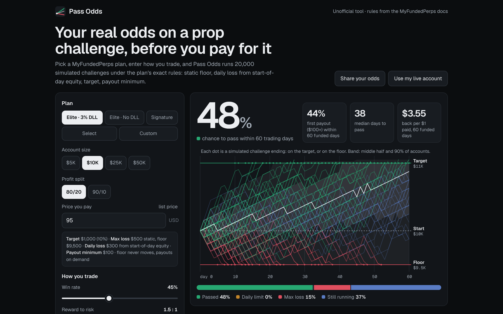

# Pass Odds

Your real odds on a prop challenge, before you pay for it.

Pick a MyFundedPerps plan, enter how you trade (win rate, reward to risk, risk per trade, trades per day, when you stop), and Pass Odds runs 20,000 simulated challenges under the plan's exact rules. It tells you:

- your chance to **pass**, to get a **first payout**, and to **blow up**;
- the **median number of trading days** to pass;
- the **money back per $1 paid**, from the payouts of the first 60 funded days;
- the **best risk per trade** for your stats and your patience;
- how **every MyFundedPerps plan** compares with your stats;
- your odds **from where your live account stands**, through the API.

Then it turns the result into a share card for X, and into a rules file for a guard.



## Try it

Open `index.html` in a browser, or the live page: https://vegatbil-hub.github.io/pass-odds/

No account, no key, no tracking. Everything runs in your browser.

## How it works

- Each simulated trade wins `reward × risk` with your win rate, or loses `risk`. Up to your trades per day, stopping early after your loss limit.
- The account fails the moment equity touches the **static floor**, or falls below **start-of-day equity minus the daily allowance**. It passes the moment equity touches the **target**.
- A passed account starts funded at the same balance and floors and is followed for 60 trading days. At the end of each day, if profit is at least your payout goal, it is withdrawn. On Elite the floor never moves; on Select and Signature it locks at the start balance after the first payout, so the simulated trader keeps half a max loss as a cushion.
- Results are counted within your patience (20 to 120 trading days, or no limit). Unresolved accounts are "still running".
- The random generator is seeded: same inputs, same numbers. The engine runs in a Web Worker (about 250,000 simulated accounts per change, under a second).

Checks against closed forms (200,000 paths): with a 50 % win rate, 1 : 1, no daily limit, a 10 % target and a 5 % static loss, gambler's ruin gives 33.3 %; the engine returns 32.7 % passed with 1.4 % still unresolved after 400 days. With a 55 % win rate: 86.7 % against 86.8 %.

Rules come from the MyFundedPerps docs (Challenges and rules, Elite accounts, Payouts), read on 24 November 2026. Elite list prices come from the Elite guide; sales change them, so type what you pay. Signature and Select prices are not published in the docs.

## From where you stand: your live account

`tools/snapshot.py` reads one account through the MyFundedPerps API and prints numbers only (equity, floors, room left, distance to target, rule percentages). Paste the result into the page.

```bash
export MFP_API_KEY=fp_test_...      # sandbox; or fp_live_... (read scope is enough)
python3 tools/snapshot.py           # first active evaluation
python3 tools/snapshot.py --account ACCOUNT_ID
```

- Two GET requests only: `GET /v1/accounts`, then `GET /v1/accounts/{id}` (its `risk` snapshot).
- The key comes from your environment or Colab Secrets, goes only to the MyFundedPerps host that matches its prefix (`fp_test_` to the sandbox, `fp_live_` to live), and is never printed or saved.
- The snapshot holds no key and no account id. The web page never sees a key.
- In Colab: open `tools/snapshot_colab.ipynb`, add `MFP_API_KEY` in Secrets, run.

## Next: Rulebound Guard

The "rules a guard can enforce" box exports your plan (max risk per trade, trades per day, stop after losses, daily stop, payout point) as JSON. The next build reads that file and watches the account through the account stream: it warns before an order breaks a rule, and can cancel or flatten through the API if you allow it.

## Limits

- Every trade risks the same amount and ends at its stop or its target. Slippage, fees, partial exits and correlated days make real odds a little worse.
- Your win rate and reward to risk are the inputs that matter most and the hardest to know. Use at least 50 of your own logged trades.
- Odds, not promises. Not financial advice.

Pass Odds is an independent tool. It is not affiliated with or endorsed by MyFundedPerps.

## Credits

Built by Vega ([@vegaatrade](https://x.com/vegaatrade)), with AI assistance (Claude). MIT license.
